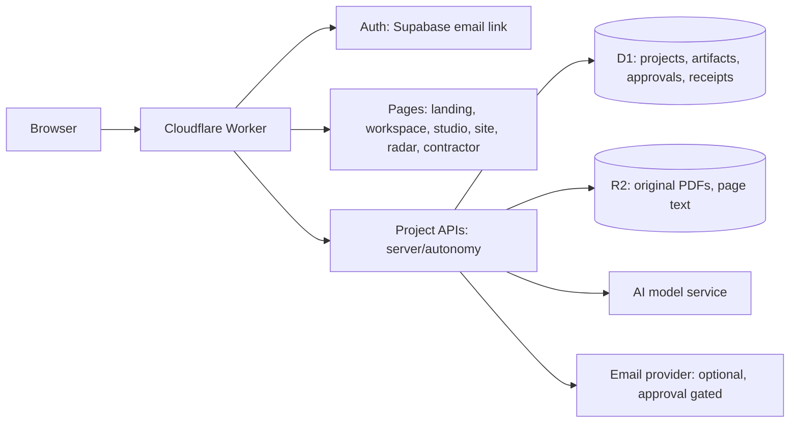

# Architecture

Schema is one Cloudflare Worker that serves a Next-style app (built with Vinext), a set of project APIs, and the tools listed below. State lives in D1 and R2. Model access is configured privately on the server.

## Tools

| Tool | Route | What it does | Status |
| --- | --- | --- | --- |
| Project workspace | `/app` | Brief and PDFs to understanding, concept, permit strategy and reviewed handoff, with approval gates | Live |
| Missing-information tracker | `/app` | Status, owner and linked file for each open question | Live |
| Corrections desk | `/app` | Human-confirmed reviewer register, exact response review, independent checks | Live |
| Studio | `/studio` | Idea to 3D model, climate time-lapse, codes and permit package | Screening aid |
| Site view | `/site` | Map digital twin, 3D context and Use my location | Live |
| Climate | `/simulate` | Weather-archive durability screening | Screening aid |
| Photorealistic 3D | `/real3d` | Google 3D Tiles city view | Live |
| Subsurface radar | `/radar` | Simulated GPR and tilt telemetry with AI inversion | Simulated demo |
| Contractor hub | `/contractor` | Punch list, missing items and RFI coordination | Live, local state |

## Design rules

1. **Humans decide.** Every consequential step stops at an approval gate. Nothing is sent, filed or submitted without explicit approval of the exact content.
2. **Evidence first.** Claims keep their source page or citation. Unread pages stay visible.
3. **Honest limits.** Concepts, screening results and the radar demo are decision aids, not permit drawings, code compliance or safety certification. See [SCOPE](SCOPE.md).
4. **Secrets stay on the server.** Keys live in Worker secrets or the ignored `.dev.vars`, never in the browser or a `VITE_` variable. See [SECURITY](../SECURITY.md).

## Where to look

| Area | Files |
| --- | --- |
| Agent loop and budgets | `server/autonomy/runner.ts`, `server/autonomy/recovery.ts` |
| Durable state | `server/autonomy/repository.ts`, `db/`, `drizzle/` |
| Documents | `server/autonomy/documents.ts` |
| Approvals and email | `server/autonomy/mail.ts` |
| Radar physics and inversion | `src/radar/` |
| Workspace UI | `src/components/AgentWorkspace.tsx`, `src/components/MissingInfoTracker.tsx` |
| Auth | `worker/supabase-auth.ts` |
